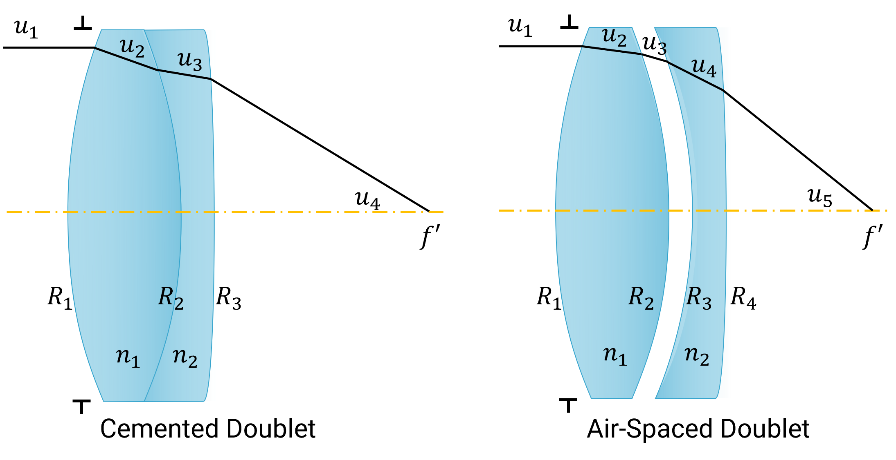
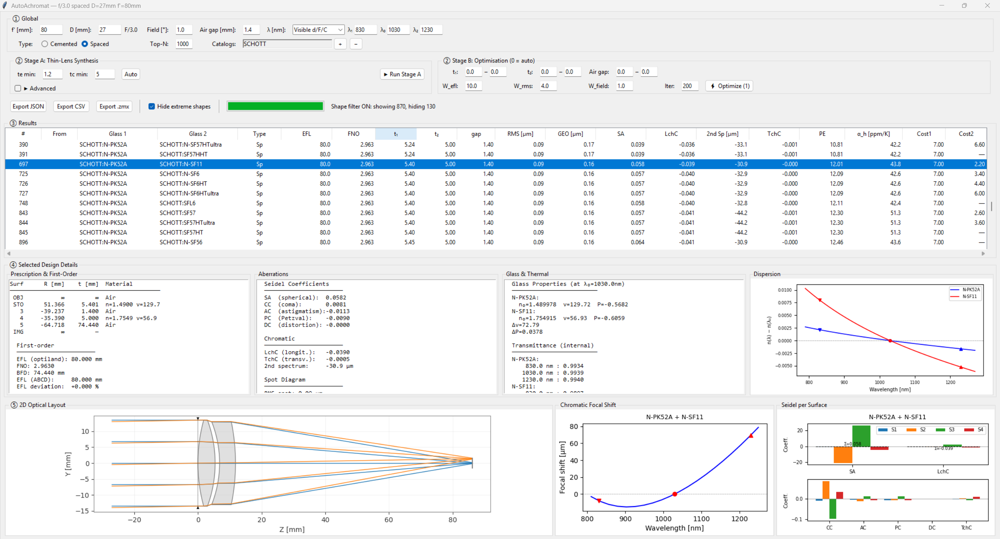
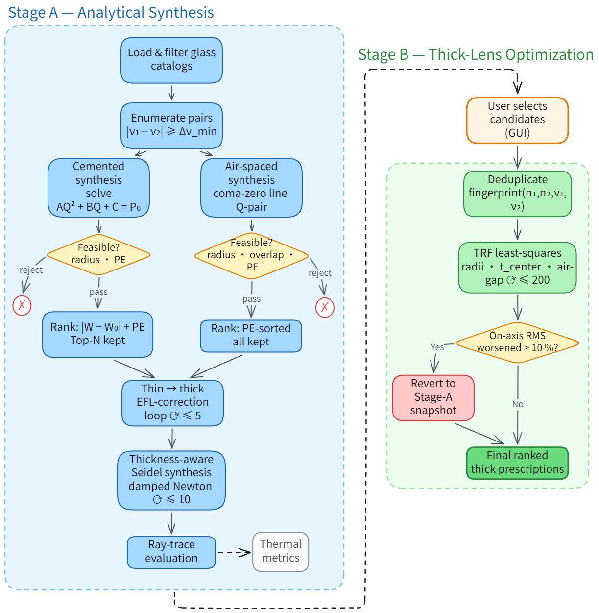

# AutoAchromat

Automated achromatic doublet lens designer. Generates initial cemented or air-spaced doublet structures from glass catalogs, evaluates their optical performance by ray tracing alongside manufacturing-feasibility and thermal checks, and exports designs for further optimization in optical design software.



**Doublet Designer GUI (reference)**



## What It Does

1. Reads industry-standard AGF glass catalogs (SCHOTT, OHARA, CDGM, etc.)
2. Automatically searches all valid glass pair combinations
3. Supports user-defined aberration targets (spherical aberration, coma, chromatic aberration) via Advanced settings
4. Produces thick-lens prescriptions with manufacturing-feasible thicknesses
5. Evaluates each design: spot size, Seidel aberrations, chromatic errors, secondary spectrum, thermal stability
6. Optionally refines designs via built-in numerical optimizer (optiland, experimental)
7. Exports the best candidates as `.zmx` (Zemax), JSON, or CSV

## How It Works

A two-stage pipeline: **Stage A** synthesizes and screens doublet candidates
from thin-lens Seidel theory, then ray-traces them; **Stage B** (optional)
refines the best designs with a least-squares optimizer.



## Installation

This project uses [uv](https://docs.astral.sh/uv/) for environment and dependency management.

```bash
git clone <repo-url>
cd AutoAchromat
uv sync
```

`uv sync` creates a `.venv/`, installs all dependencies from `uv.lock`, and installs the project in editable mode. Activate the environment with `.venv\Scripts\activate` (Windows) or `source .venv/bin/activate` (macOS/Linux), or run commands directly via `uv run`, e.g. `uv run autoachromat-gui`.

Requires Python >= 3.10 (uv will download a matching interpreter automatically if none is found). Dependencies (`numpy`, `optiland`, `scipy`, `matplotlib`) are installed automatically.

## Quick Start

```bash
uv run autoachromat-gui
```

(Or, after activating `.venv`: `autoachromat-gui` / `python -m autoachromat.gui`.)

### Step 1: Set Parameters

In the Global panel, configure:
- **f', D** — focal length and aperture (F/# displayed automatically)
- **Wavelengths** — select from presets (Visible, NIR, SWIR, MWIR, LWIR) or enter manually in nm
- **Field angle** — used for off-axis aberration evaluation in Stage A and as an optimization target in Stage B
- **Air gap** — fixed during Stage A synthesis, becomes a free variable in Stage B (spaced doublets only)
- **Catalogs** — load one or more AGF glass catalog files

### Step 2: Run Stage A

The system automatically sets minimum edge/center thicknesses (te min, tc min) based on the aperture diameter according to standard manufacturing tables. You can override these values for specific manufacturing requirements, or click **Auto** to reset to the recommended defaults.

Click **Advanced** to set custom aberration targets (SA, Coma, LCA — default 0 = fully corrected) and screening thresholds (minimum Abbe number difference, maximum PE).

Click **Run Stage A** to search all glass pair combinations. Results appear in a sortable table ranked by aberration performance.

For air-spaced doublets, check **Hide extreme shapes** to filter out meniscus designs with the convex surface facing the air gap, which are difficult to manufacture and mount.

### Step 3: Analyze Results

Select any row to see:
- Prescription & first-order data
- Seidel aberration coefficients
- Glass properties, transmittance, and thermal analysis
- 2D optical layout drawing
- Chromatic focal shift curve
- Per-surface Seidel bar chart
- Dispersion comparison of the two glasses

### Step 4: Optimize (Stage B, experimental)

Select one or more rows in the results table and click **Optimize**. This runs a numerical optimizer (optiland LeastSquares) that refines radii, thicknesses, and air gap to minimize spot size while preserving focal length.

> **Note:** Stage B is slow (~10-30s per candidate) and still experimental. Merit function weights (W_efl, W_rms, W_field) and iteration count can be adjusted in the Stage B panel.

### Step 5: Export

- **Export .zmx** — export selected design to Zemax for further optimization
- **Export JSON / CSV** — export full results table

## Command-Line (Batch) Use

In addition to the GUI, the project installs an `autoachromat` command for headless / scriptable runs. It reads a JSON config, runs the full Stage A pipeline (thin-lens synthesis → thickening → ray tracing), prints a ranked results table, and can export the results to JSON.

```bash
uv run autoachromat --config config.json
uv run autoachromat --config config.json --out results.json   # also write JSON
uv run autoachromat --config config.json --thin-only          # synthesis only, skip ray tracing
uv run autoachromat --config config.json --max-n 20           # cap candidates evaluated
```

Minimal `config.json` (wavelengths in nm; `catalogs` paths are resolved relative to the config file):

```json
{
  "system_type": "spaced",
  "fprime": 100.0,
  "D": 25.0,
  "lam1": 486.13,
  "lam0": 587.56,
  "lam2": 656.27,
  "C0": 0.0,
  "P0": 0.0,
  "W0": 0.0,
  "min_delta_nu": 10.0,
  "max_PE": 0.01,
  "air_gap": 1.0,
  "N": 50,
  "catalogs": ["data/catalogs/SCHOTT.AGF"]
}
```

> **Note:** The CLI covers Stage A only. Stage B (numerical optimization) is available exclusively in the GUI.

## Glass Catalogs

The repo includes Schott, OHARA, and CDGM catalogs in `data/catalogs/`. To add other vendors, copy the corresponding `.AGF` file (e.g. `HOYA.AGF`) from your Zemax installation into `data/catalogs/`.

## Running Tests

```bash
uv run pytest
```

## Acknowledgements

This work was inspired by:

> D. H. Nguyen and A. V. Bakholdin, "Calculation automation of 'cemented doublet
> with a singlet' and 'singlet with a cemented doublet' objectives," *Journal of
> Optical Technology* **90**(1), 6–13 (2023). https://doi.org/10.1364/JOT.90.000006
